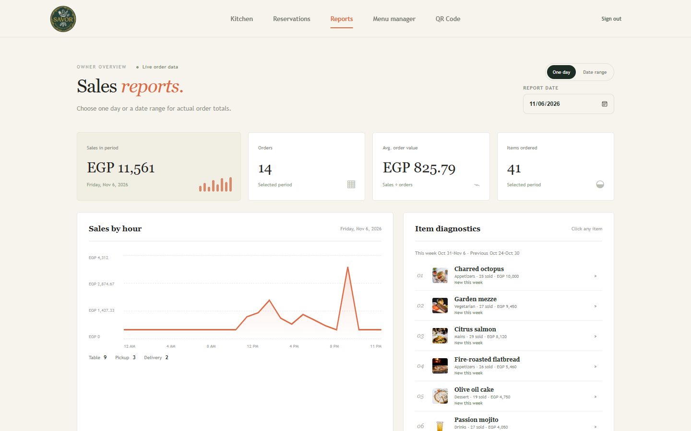
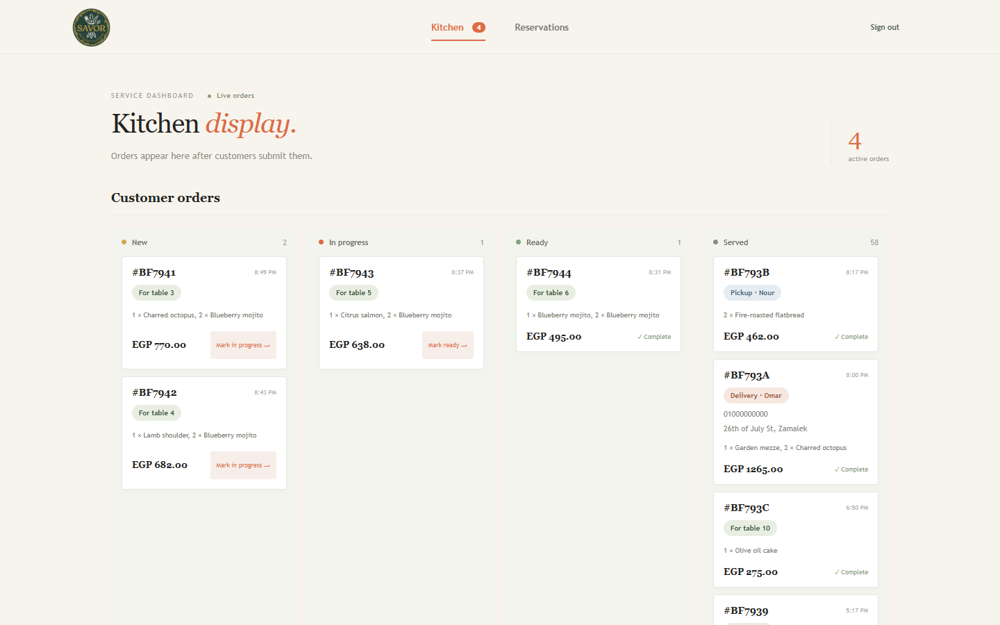
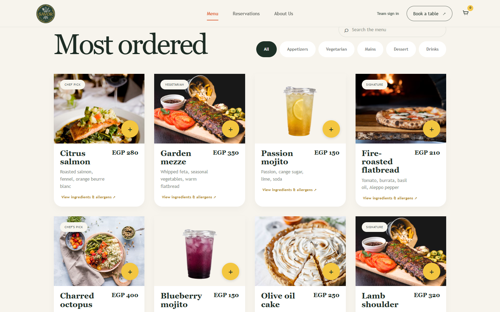
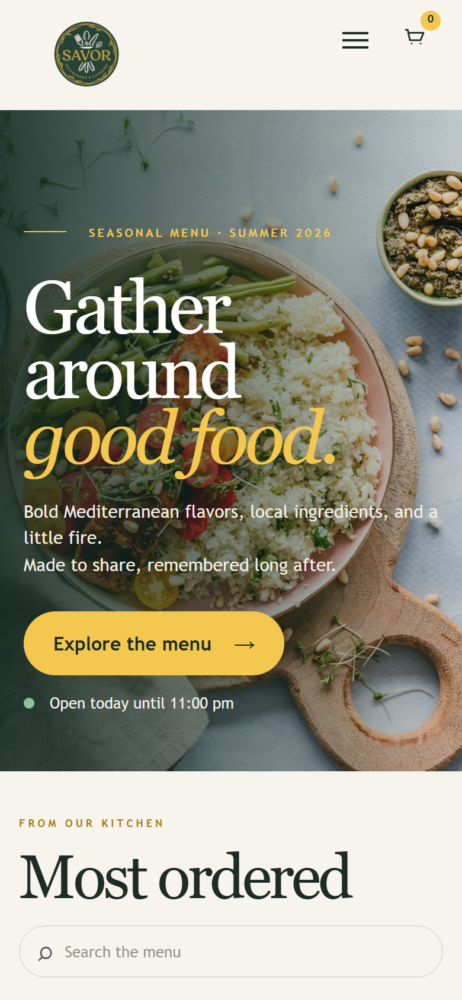
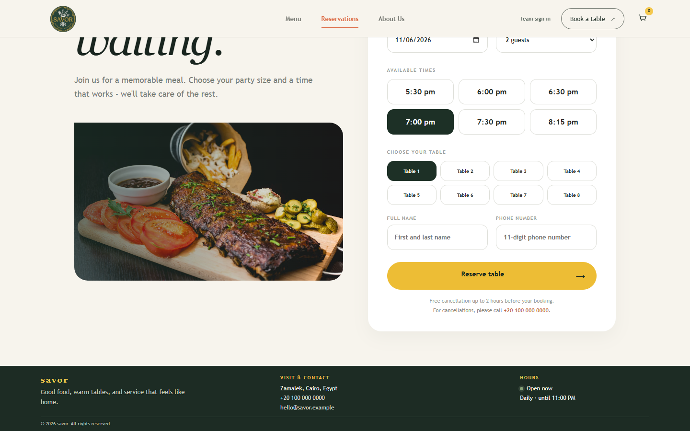
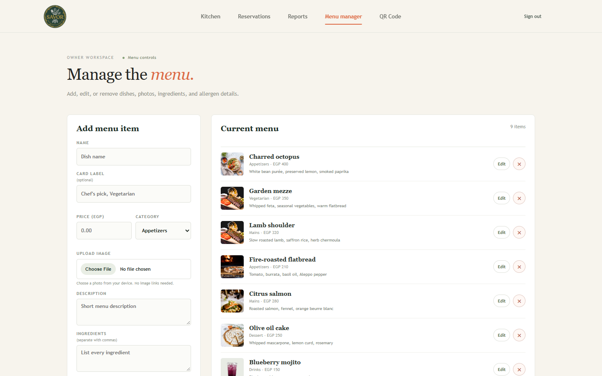
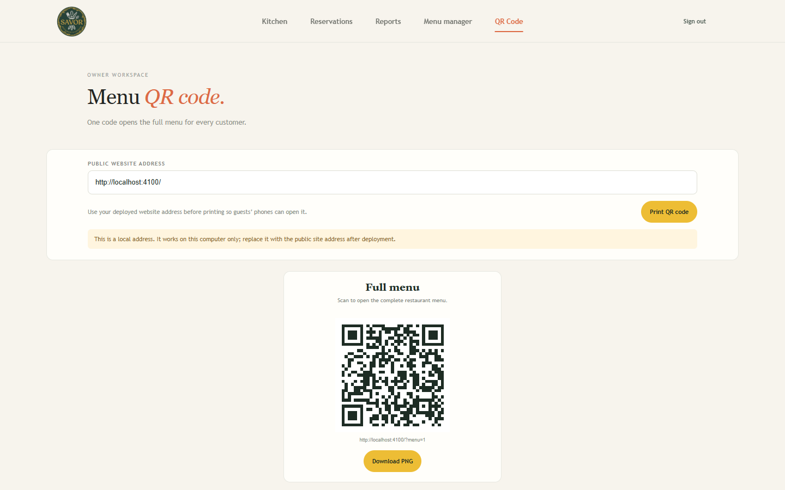

# Savor Restaurant

Restaurant ordering and table reservation system. Customers scan a QR code (or open the site) to browse the menu, order to their table, for pickup or for delivery, and book a table. The kitchen sees orders live, and the owner gets daily sales reports, a menu manager and printable QR codes.

**Stack:** React · Node.js + Express · MongoDB (Mongoose) · Socket.io

**Live demo:** _add your Render link here after deploying (see [Deploy](#deploy-free-on-render))_

| Demo login (choose **Team sign in**) | Email | Password |
| --- | --- | --- |
| Kitchen / staff | `staff@savor.restaurant.eg` | `savor2026` |
| Owner | `owner@savor.restaurant.eg` | `savor2026` |

---

## Features

| Area | What it does |
| --- | --- |
| **QR menu** | One QR code opens the menu on the guest's phone (`/?menu=1`). The owner can print or download it from **QR Code**. |
| **Digital menu** | Categories, photos, search, tags, and ingredients and allergens for each dish. |
| **Cart & ordering** | Cart with quantities. Order for a table, for pickup or for delivery (delivery can use the phone's location). |
| **Live kitchen display** | New orders appear instantly over Socket.io in New → In progress → Ready → Served columns. One tap moves an order on. |
| **Table reservations** | Guests pick a date, time and party size within opening hours. Staff see and manage bookings. |
| **Owner dashboard** | Sales for one day or a date range: revenue, orders, average order value, items sold, sales by hour, order type split and best-selling items. |
| **Menu manager** | The owner adds, edits or deletes dishes. Changes show on the customer menu. |
| **Staff accounts** | Kitchen and owner logins with JWT and bcrypt-hashed passwords; each role sees only its own screens. |

### Screenshots

**Owner dashboard: daily sales report**



**Kitchen display: live orders**



**Digital menu**



| Phone (QR menu link) | Table reservations |
| --- | --- |
|  |  |

| Menu manager (owner) | QR code (owner) |
| --- | --- |
|  |  |

---

## Deploy free on Render

The repo includes [`render.yaml`](render.yaml), so deploying takes a few clicks:

1. Sign in at [render.com](https://render.com) with GitHub.
2. Choose **New → Blueprint**, pick this repository, and click **Apply**.
3. When the build finishes (about 5 minutes), open the `https://savor-restaurant-….onrender.com` link. That is the live demo.

One server builds the React app and serves the website, the API and live updates from the same address, so the QR codes work on any phone.

- **Database:** with no `MONGODB_URI` set, the server starts a built-in demo database with sample orders and the demo logins above. It resets when the server restarts. To keep data permanently, create a free MongoDB Atlas cluster and add its connection string as `MONGODB_URI` under the service's **Environment** tab in Render.
- **Free tier:** the service sleeps after 15 minutes without visitors, so the first visit after that takes about a minute to wake it up.

## Run locally

Requires Node.js 20 or newer. MongoDB is optional.

```bash
npm install
npm install --prefix server
cp server/.env.example server/.env   # leave MONGODB_URI empty to use the built-in demo database
```

Development mode (two terminals):

```bash
npm run server   # API + Socket.io on http://localhost:4000
npm start        # React app on http://localhost:3000
```

Production mode (one server, the same setup as Render):

```bash
npm run build
npm start --prefix server   # website + API on http://localhost:4000
```

See [server/README.md](server/README.md) for the API routes and for creating your own team accounts.
